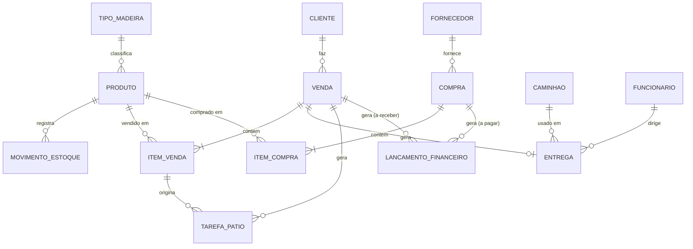
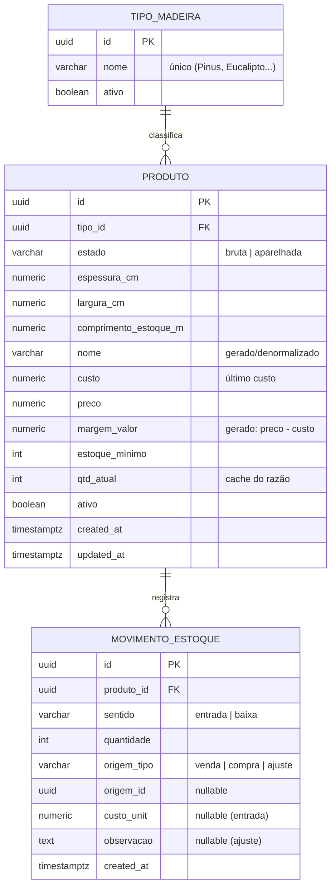
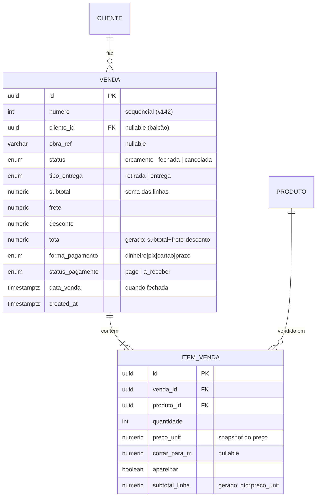
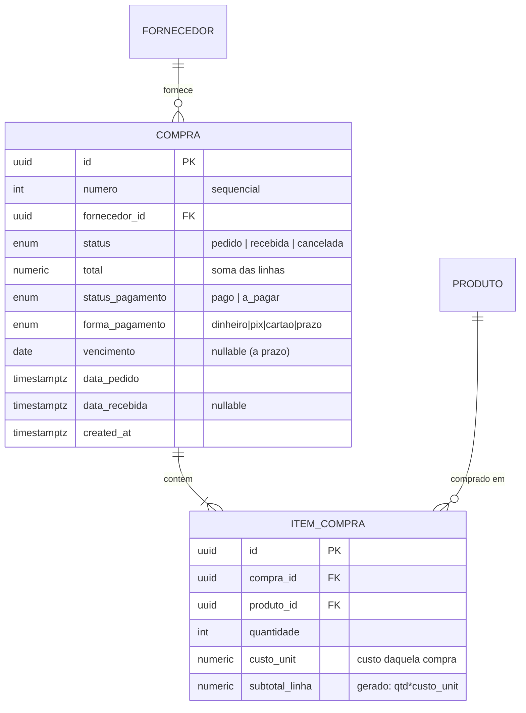
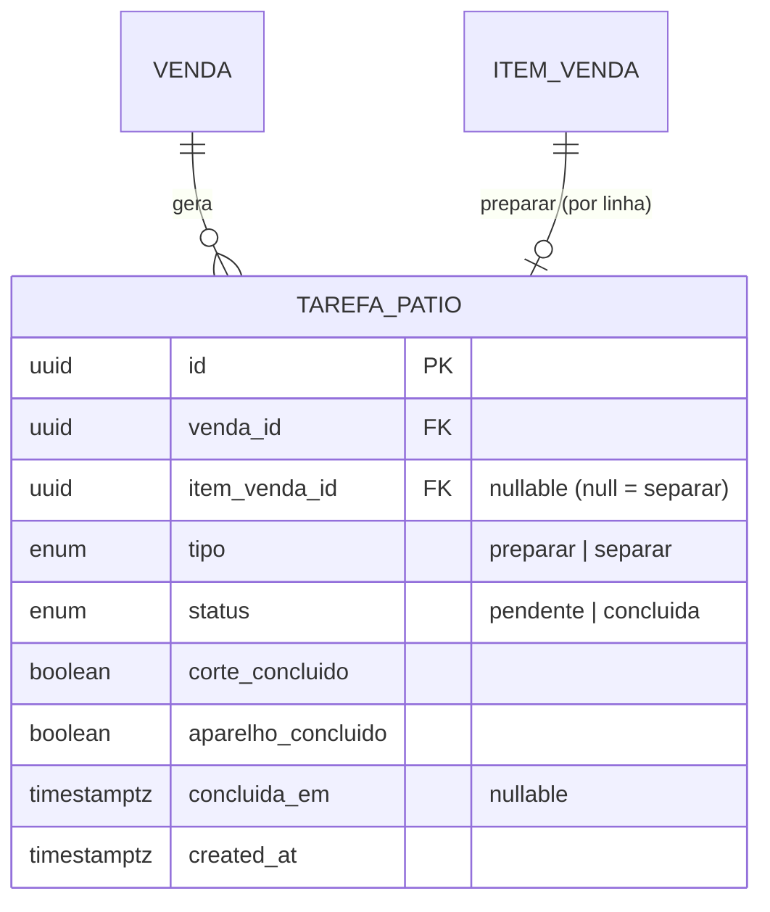
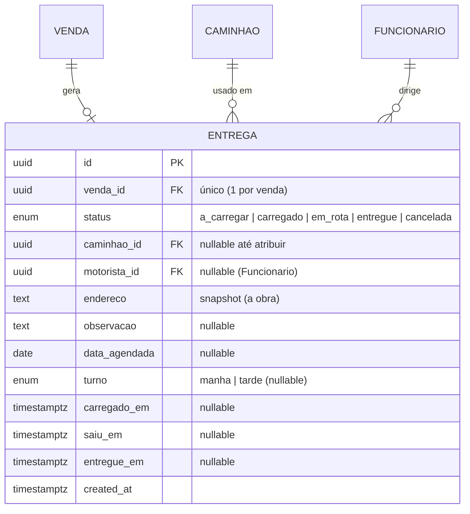
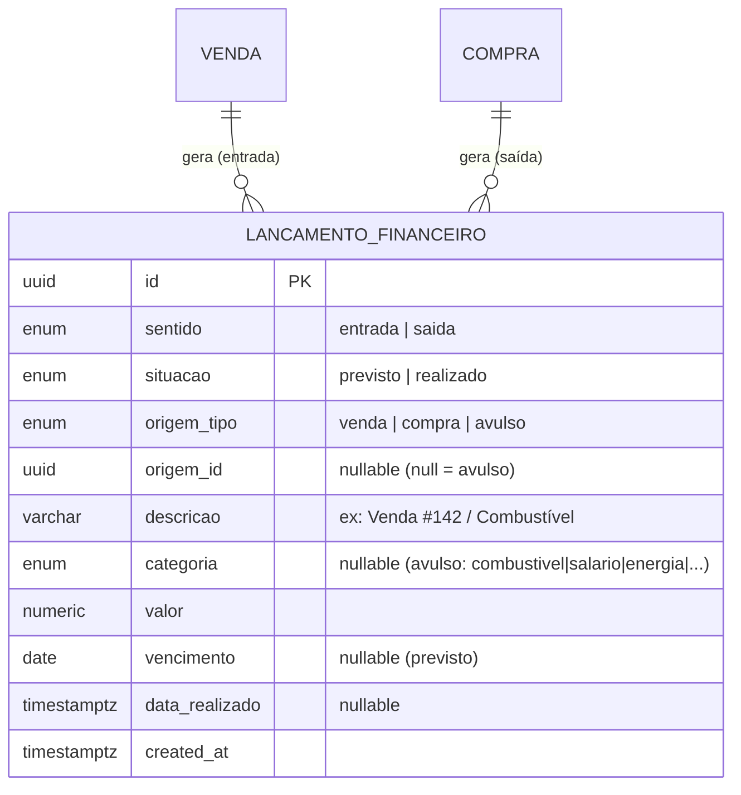
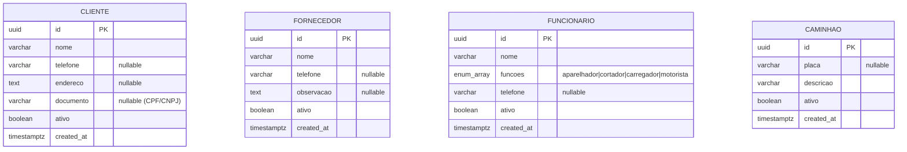

# Modelo de Dados — Visão Geral (Macro)

> **Fase:** modelagem de dados — visão macro (entidades + relações).
> **Detalhe por entidade** (atributos, tipos, chaves, regras) será feito num próximo passo, entidade por entidade.
> Origem: [requisitos-funcionais.md](requisitos-funcionais.md).

---

## 1. As entidades em uma linha cada

| Entidade | É… | Principais atributos (resumo) |
|---|---|---|
| **TipoMadeira** | lista gerenciada de espécies | nome (Pinus, Eucalipto…) |
| **Produto** | a madeira no estoque (o "SKU") | tipo, estado, espessura, largura, comp_estoque, custo, preço, estoque_mínimo, qtd_atual, nome_gerado |
| **MovimentoEstoque** | razão de cada entrada/baixa | produto, sentido (entrada/baixa), qtd, origem, data |
| **Cliente** | quem compra | nome, telefone, endereço |
| **Fornecedor** | de quem se compra | nome, telefone |
| **Funcionario** | equipe | nome, função (aparelhador/cortador/carregador/motorista) |
| **Caminhao** | veículo de entrega | placa, descrição |
| **Venda** | venda ou orçamento | cliente, obra, status, subtotal, frete, desconto, total, pagamento |
| **ItemVenda** | uma linha da venda | produto, qtd, preço_unit, cortar_para, aparelhar |
| **Compra** | compra ou pedido | fornecedor, status, total, pagamento, vencimento |
| **ItemCompra** | uma linha da compra | produto, qtd, custo_unit |
| **TarefaPatio** | trabalho no pátio | venda, item, tipo (preparar/separar), passos, status |
| **Entrega** | logística da venda | venda, status, caminhão, motorista, data, turno, endereço |
| **LancamentoFinanceiro** | dinheiro a entrar/sair/movido | sentido, situação, origem, valor, vencimento |

---

## 2. Diagrama (texto)

```
   TipoMadeira ──1:N──► Produto ◄───────────────┐
                          │                      │ N:1
                          │ 1:N                  │
                          ▼                      │
                  MovimentoEstoque               │
                 (origem: venda|compra|ajuste)   │
                                                 │
   Cliente ─1:N─► VENDA ─1:N─► ItemVenda ─N:1────┤
                    │                            │
                    ├─1:1──► Entrega ─► Caminhao  │
                    │            └────► Funcionario (motorista)
                    ├─1:N──► TarefaPatio ◄─(0..1)─ ItemVenda
                    └─1:N──► LancamentoFinanceiro  (a receber)

   Fornecedor ─1:N─► COMPRA ─1:N─► ItemCompra ─N:1┘
                    │
                    └─1:N──► LancamentoFinanceiro  (a pagar)

   LancamentoFinanceiro também aceita lançamento AVULSO (sem venda/compra).
```

---

## 3. Diagrama (Mermaid — renderiza no preview)



---

## 4. Relações e cardinalidades (explicadas)

- **TipoMadeira 1 — N Produto** — cada produto tem um tipo; um tipo classifica vários produtos.
- **Produto 1 — N MovimentoEstoque** — todo entra/sai de estoque é uma linha aqui (rastreabilidade, RF-G1). A `origem` aponta para a Venda, Compra ou um ajuste manual.
- **Cliente 1 — N Venda** / **Fornecedor 1 — N Compra**.
- **Venda 1 — N ItemVenda** / **Compra 1 — N ItemCompra** — cada item referencia um Produto (N:1).
- **Venda 1 — 0..1 Entrega** — só existe se a venda for "Entregar" (retirada não cria Entrega).
- **Venda 1 — N TarefaPatio** — geradas no fechamento; cada tarefa pode apontar para um ItemVenda específico (preparar) ou para a venda toda (separar).
- **Entrega N — 1 Caminhao** e **Entrega N — 1 Funcionario** (papel motorista).
- **LancamentoFinanceiro** — polimórfico na origem: pode vir de uma Venda (a receber), de uma Compra (a pagar) ou ser **avulso** (RF-F5). Atributos-chave: `sentido` (entrada/saída) e `situacao` (previsto/realizado) — é isso que separa "a receber/a pagar" de "já no caixa".

---

## 5. Como a cascata do "Fechar Venda" (RF-X1) vira escrita no banco

Um único evento grava em várias tabelas:

```
Fechar Venda  ─►  Venda.status = fechada
              ├─►  MovimentoEstoque (baixa)         para cada ItemVenda
              ├─►  TarefaPatio (preparar/separar)   conforme itens
              ├─►  Entrega (a_carregar)             se entrega
              └─►  LancamentoFinanceiro             (realizado se pago, previsto se a receber)
```

Simétrico no "Marcar Compra Recebida" (entrada de estoque + atualiza custo do Produto + lançamento a pagar).

---

---

## 6. Detalhe — Produto (+ TipoMadeira, MovimentoEstoque)

### Diagrama detalhado



### Atributos da Produto

| Campo | Tipo (Postgres) | Regra / observação |
|---|---|---|
| `id` | `uuid` PK | gerado |
| `tipo_id` | `uuid` FK → TipoMadeira | obrigatório |
| `estado` | `varchar` + CHECK | `'bruta'` ou `'aparelhada'` |
| `espessura_cm` | `numeric(5,2)` | > 0 |
| `largura_cm` | `numeric(5,2)` | > 0 |
| `comprimento_estoque_m` | `numeric(5,2)` | > 0 |
| `nome` | `varchar` | denormalizado, gerado pelo serviço (tipo+estado+medidas) |
| `custo` | `numeric(12,2)` | último custo (atualizado ao receber compra) |
| `preco` | `numeric(12,2)` | preço de venda/peça |
| `margem_valor` | `numeric` GENERATED | `preco - custo` (coluna calculada pelo banco) |
| `estoque_minimo` | `int` | gatilho do alerta |
| `qtd_atual` | `int` | cache do razão (soma de MovimentoEstoque) |
| `ativo` | `boolean` | soft delete (preserva histórico) |
| `created_at` / `updated_at` | `timestamptz` | auditoria |

### Regras, chaves e índices
1. **Único** em `(tipo_id, estado, espessura_cm, largura_cm, comprimento_estoque_m)` — anti-duplicata.
2. **`nome` denormalizado** — montado pelo serviço (NestJS) a cada mudança de atributo (depende do nome do tipo em outra tabela, por isso não é GENERATED puro). Acelera busca sem JOIN.
3. **Busca tolerante (RF-E4)** — índice `GIN` com extensão `pg_trgm` sobre `nome` (busca tipo "pinus 5 30").
4. **`margem_valor`** = `GENERATED ALWAYS AS (preco - custo) STORED`. Margem % fica no app (evita divisão por custo zero).
5. **`qtd_atual` é cache** do razão `MovimentoEstoque`; atualizado na mesma transação do movimento. Índice **parcial** `WHERE qtd_atual <= estoque_minimo` para a Reposição sugerida instantânea.
6. **`ativo`** — produto com histórico nunca é apagado; vira inativo.

### MovimentoEstoque (razão de estoque)
- `sentido`: `entrada` | `baixa`. `quantidade` sempre positiva (o sentido define o sinal).
- `origem_tipo`/`origem_id`: liga ao que causou o movimento (Venda, Compra ou ajuste manual).
- `custo_unit`: preenchido nas entradas (alimenta o "último custo" do Produto).
- Regra: **toda** escrita aqui acontece junto da atualização de `Produto.qtd_atual`, na mesma transação.

### Decisão de engenharia
- `estado` modelado como `varchar`+CHECK (2 valores fixos hoje), promovível a tabela gerenciável depois se surgir novo estado (ex.: "beneficiada"). RF-C5 mantido conceitualmente.

---

---

## 7. Detalhe — Venda + ItemVenda (coração transacional)

### Diagrama detalhado



### Decisões dessas tabelas
1. **`numero`** sequencial humano (#142) via sequence; `id` uuid é a chave técnica.
2. **`preco_unit` é snapshot** do preço no momento da venda (não referência viva a `Produto.preco`) — vendas antigas não mudam se o preço for reajustado. Vale também para o nome do produto (histórico fiel).
3. **`total` e `subtotal_linha`** são colunas `GENERATED` (subtotal+frete−desconto; qtd×preco_unit).
4. **`cliente_id` nullable** para venda de balcão sem cadastro.
5. Campos de domínio fixo (`status`, `tipo_entrega`, `forma_pagamento`, `status_pagamento`) como **enums** Postgres.

### Cascata do "Fechar Venda" (RF-X1) em transação única

```
BEGIN
  1. VALIDA estoque por item (SELECT ... FOR UPDATE no produto)
        se qtd_atual < quantidade em qualquer item → ROLLBACK (bloqueia, RF-V10)
  2. UPDATE venda SET status='fechada', data_venda, forma_pagamento, status_pagamento
  3. PARA CADA item_venda:
        INSERT movimento_estoque (sentido='baixa', qtd, origem='venda', origem_id)
        UPDATE produto SET qtd_atual = qtd_atual - quantidade
        SE cortar_para OU aparelhar: INSERT tarefa_patio (tipo='preparar', item_venda_id)
  4. SE retirada: INSERT tarefa_patio (tipo='separar', venda_id)
     SE entrega:  INSERT entrega (status='a_carregar', venda_id, endereço)
  5. INSERT lancamento_financeiro (sentido='entrada', origem='venda', valor=total,
        situacao = pago ? 'realizado' : 'previsto', vencimento se a_receber)
COMMIT
```

Regras: atomicidade total; `FOR UPDATE` previne venda concorrente da mesma peça; **orçamento não dispara nada** (RF-V9, só grava Venda+ItemVenda); **cancelar venda fechada** gera movimento inverso (estorno) + cancela lançamentos (fluxo a refinar depois).

---

---

## 8. Detalhe — Compra + ItemCompra (espelho da Venda)

### Simetria Venda × Compra
| | Venda | Compra |
|---|---|---|
| Documento / Linhas | Venda / ItemVenda | Compra / ItemCompra |
| Estados | orcamento → fechada | pedido → recebida |
| Estoque | baixa (−) | entrada (+) |
| Produto | usa o preço | atualiza o custo |
| Financeiro | a receber (entrada) | a pagar (saída) |
| Parceiro | Cliente | Fornecedor |

### Diagrama detalhado



### Cascata do "Marcar Recebida"

```
BEGIN
  1. UPDATE compra SET status='recebida', data_recebida=now()
  2. PARA CADA item_compra:
        INSERT movimento_estoque (sentido='entrada', qtd, origem='compra', origem_id, custo_unit)
        UPDATE produto SET qtd_atual = qtd_atual + quantidade
        UPDATE produto SET custo = item.custo_unit   (novo "último custo")
  3. INSERT lancamento_financeiro (sentido='saida', origem='compra', valor=total,
        situacao = pago ? 'realizado' : 'previsto', vencimento se a_pagar)
COMMIT
```

### Detalhes
1. **Pedido não mexe em estoque** (RF-CP3); estoque só entra ao Receber.
2. Atualizar `produto.custo` **recalcula `margem_valor`** automaticamente (coluna GENERATED).
3. O **"+Entrada" do Estoque (RF-E6)** é atalho: cria Compra já `recebida` com 1 item → mesma cascata (única via para somar estoque).
4. `custo_unit` por linha (cada produto tem seu custo).
5. Cancelar compra recebida → movimento inverso (estorno) + cancela a pagar (refinar depois).

---

---

## 9. Detalhe — TarefaPatio

### Diagrama


### Princípio
A tarefa **não duplica a instrução** — o "o que fazer" (`cortar_para_m`, `aparelhar`) vive no `ItemVenda`. A TarefaPatio só aponta pro item e rastreia **progresso** (estado do checklist). Fonte única da instrução = ItemVenda.

### Dois tipos
| Tipo | Nasce quando | Aponta pra | Checklist |
|---|---|---|---|
| `preparar` | item com corte e/ou aparelhar | um ItemVenda | passos aplicáveis (corte/aparelho) |
| `separar` | venda de retirada | a Venda (item nulo) | sem passos, só concluir |

Uma venda de retirada pode gerar **os dois** (separar + preparar de um item que precisa corte) — coberto naturalmente (preparar nasce por item, separar por venda).

### Regras
- **Trava (RF-P5):** no nível da **venda** — entrega não vai pra "carregado" se `EXISTS tarefa_patio WHERE venda_id = X AND status='pendente'`. Item-level para *mostrar*, venda-level para *travar*.
- **Carregar NÃO é tarefa de pátio** — é status da Entrega (`a_carregar → carregado`). Pátio = só `preparar` e `separar`.
- Checklist com **dois booleanos** (corte_concluido, aparelho_concluido); tarefa vira `concluida` quando todos os passos aplicáveis estão feitos (registra `concluida_em`).
- `responsavel_id` (Funcionario) reservado para **v2** (produtividade); ausente no MVP.

---

---

## 10. Detalhe — Entrega

### Diagrama


### Regras
- **1:1 com Venda** (`UNIQUE venda_id`); só existe para `tipo_entrega='entrega'`. **Retirada não cria Entrega** (resolve-se com tarefa `separar` + cliente buscando).
- **`endereco` é snapshot** — vai para a obra, que pode diferir do endereço do cliente; puxado como sugestão, editável, congelado na entrega.
- **Carimbos de tempo** (`carregado_em/saiu_em/entregue_em`) dão a linha do tempo sem tabela de histórico separada.
- **Não toca estoque** (RF-EN7); só muda status.
- **Trava do pátio (RF-EN8)** na transição `a_carregar → carregado`.
- **Decisão MVP:** 1 venda = 1 entrega (entrega leva todos os itens). **Entrega parcial** (tabela `ItemEntrega` + várias entregas por venda) fica para **v2**.

---

---

## 11. Detalhe — LancamentoFinanceiro

### A matriz que explica tudo (sentido × situacao)
```
                  PREVISTO              REALIZADO
  ENTRADA (+)   A RECEBER             entrou no caixa
  SAÍDA  (−)    A PAGAR               saiu do caixa
```
- A receber = `entrada` + `previsto` · A pagar = `saida` + `previsto`
- Saldo do caixa = soma dos `realizado` (entradas − saídas)
- Vencidos = `previsto` com `vencimento < hoje`

### Diagrama


### Decisões
- **Settlement (A): vira a chave na mesma linha.** Um "a receber/a pagar" (`previsto`) passa a `realizado` + `data_realizado` quando quitado. Uma obrigação = uma linha. (Alternativa contábil de partida dobrada = descartada para o MVP.)
- **Avulso:** `origem_tipo='avulso'`, `origem_id` nulo, com `descricao` e `categoria`. Pode ser `previsto` (conta a vencer) ou `realizado` (paguei agora).
- **Saldo inicial** do caixa = lançamento avulso `entrada/realizado` "Saldo inicial" (sem tratamento especial).
- **v2:** pagamento **parcial** (parcelas) — no MVP o pagamento é integral; e **múltiplas contas** (caixa físico × banco/pix) via futuro `conta_id` — no MVP é um caixa só.

---

---

## 12. Detalhe — Cadastros (Cliente · Fornecedor · Funcionario · Caminhao)



### Padrões
- **`ativo` (soft delete)** em todos — registros com histórico nunca são apagados, só desativados.
- Só o **nome** é obrigatório (cadastro rápido de balcão); o resto é opcional.

### Decisão — Funcionario.funcoes
- Modelado como **lista** (array de enum). Cobre os dois casos da operação real: função única (ex.: `[motorista]`, `[cortador]`) **e** acúmulo de funções (`[cortador, motorista]`) sem mudar o schema.
- O seletor de motorista na Entrega filtra `'motorista' = ANY(funcoes)`.
- v2 (se precisar de relatório por setor): promover para tabela de ligação `funcionario_funcao`.

---

## ✅ Modelagem de dados — completa

Todas as 14 entidades detalhadas: Produto, TipoMadeira, MovimentoEstoque, Venda, ItemVenda, Compra, ItemCompra, TarefaPatio, Entrega, LancamentoFinanceiro, Cliente, Fornecedor, Funcionario, Caminhao.

*Próxima fase do processo: **design** (telas/UX) e os **requisitos não-funcionais** ainda pendentes (conectividade/offline, dispositivos, backup, desempenho, impressão).*
